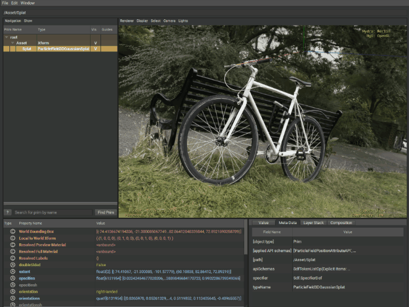
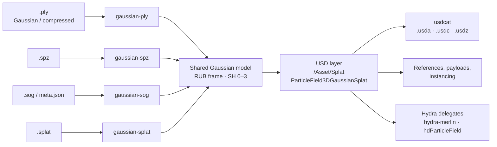
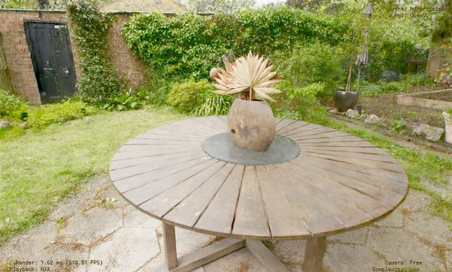
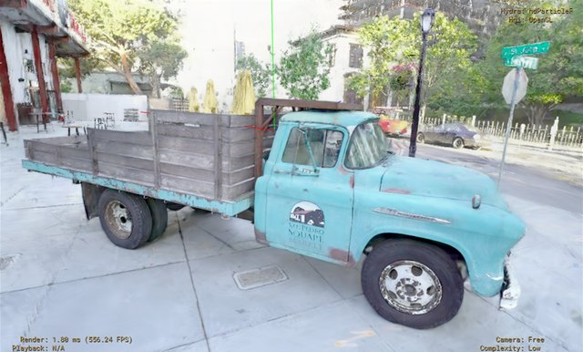
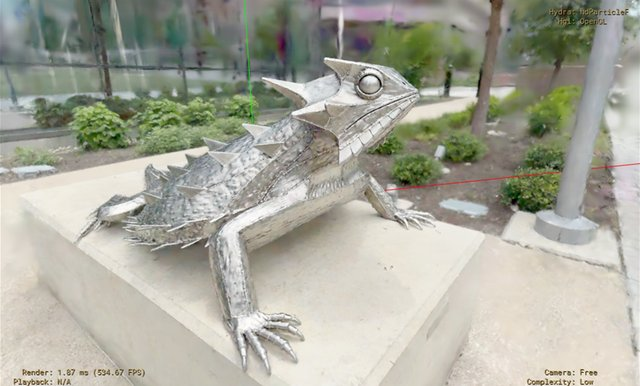

# OpenUSD 3D Gaussian Splatting Plugins

[](https://github.com/animu-sphere/usd-3dgs-plugins/actions/workflows/ost-source-ci.yml)
[](https://github.com/animu-sphere/usd-3dgs-plugins/releases/latest)
[](LICENSE)
[](docs/reference/SUPPORTED_CONFIGURATIONS.md)

**Open Gaussian splat captures — PLY, SPZ, SOG, and `.splat` — directly as
OpenUSD layers.** No conversion step, no custom schema: every file becomes a
standard `ParticleField3DGaussianSplat` that USD tools can inspect, compose,
and hand to a Hydra renderer.

<p align="center">
  
  <br />
  <sub>The Mip-NeRF 360 <code>bicycle</code> capture (Graphdeco PLY, 6.1M Gaussians)
  opened in <code>usdview</code> and rendered by the experimental
  <a href="https://github.com/animu-sphere/hydra-merlin">hydra-merlin</a> delegate.</sub>
</p>

## Highlights

- **Opens splats where USD already works.** The plugins register as
  `SdfFileFormat`s, so `usdcat`, `usdview`, Python, and other OpenUSD-based
  tools read `.ply`, `.spz`, `.sog`, and `.splat` files as layers.
- **One standard output.** Every format authors OpenUSD's
  `ParticleField3DGaussianSplat` at `/Asset/Splat`, with spherical harmonics up
  to degree 3 in a common right-up-back frame.
- **Composes like any other asset.** Reference, payload, instance, or package
  splats into USDZ alongside the rest of a scene.
- **Renderer-neutral.** The plugins author data only. Any Hydra delegate that
  implements the schema can draw it.
- **Strict by design.** Unsupported variants are rejected with stable,
  documented [diagnostic codes](docs/reference/DIAGNOSTICS.md) instead of being
  imported approximately.

## How it works



Each format has its own decoder plugin. All of them feed one shared Gaussian
model and one USD writer, so a layer authored from SPZ has the same prims,
attributes, and frame as one authored from PLY.

## Supported formats

| Format | Extensions | Variants read | SH degrees | Verified producers | Mapping |
| --- | --- | --- | :---: | --- | --- |
| **Gaussian PLY** | `.ply` | ASCII, binary little-endian, SuperSplat compressed PLY | 0–3 | Graphdeco 3DGS, Brush, Postshot, SuperSplat, SplatTransform | [PLY](docs/reference/PLY_MAPPING.md), [compressed](docs/reference/COMPRESSED_PLY_MAPPING.md) |
| **SPZ** | `.spz` | v1–v3 (gzip), v4 (Zstandard) | 0–3 | Scaniverse, SplatTransform | [SPZ](docs/reference/SPZ_MAPPING.md) |
| **SOG** | `.sog`, `meta.json` | v2 and v3, bundled ZIP or unbundled WebP planes | 0–3 | SplatTransform | [SOG](docs/reference/SOG_MAPPING.md) |
| **.splat** | `.splat` | Headerless 32-byte records | 0 | SplatTransform | [.splat](docs/reference/SPLAT_MAPPING.md) |

Import is read-only. For exact behavior, limits, and the variants that are
rejected (such as `.ksplat`, streamed SOG, and SH degree 4), see the
[capability matrix](docs/reference/CAPABILITY_MATRIX.md).

## Quick start

**1. Install.** Download the archive for your host from the
[latest release](https://github.com/animu-sphere/usd-3dgs-plugins/releases/latest),
check the [supported configurations](docs/reference/SUPPORTED_CONFIGURATIONS.md),
and follow the
[binary install guide](docs/guides/INSTALL.md#install-a-binary-release) to
verify and activate it.

**2. Open a splat as USD.**

```sh
usdcat --flatten --out scene.usda scene.ply
```

**3. Compose it into a scene.** Reference a source file directly, exactly as
you would a `.usd` file:

```usda
#usda 1.0
(
    defaultPrim = "Cloud"
    upAxis = "Y"
    metersPerUnit = 1
)

def Xform "Cloud" (
    prepend references = @./assets/cloud.ply@
)
{
}
```

The [composition guide](docs/guides/COMPOSITION.md) covers payloads,
instancing, and USDZ delivery.

**4. View it.** Stock `usdview` can inspect the stage. To see splats, use a
Hydra delegate that implements `ParticleField3DGaussianSplat`, such as
[hydra-merlin](https://github.com/animu-sphere/hydra-merlin) (see the
[verified preview setup](docs/reference/CAPABILITY_MATRIX.md#hydra-rendering))
or OpenUSD's `hdParticleField` example.

## Gallery

<table>
  <tr>
    <td align="center" width="33%">
      <a href="docs/assets/screenshots/usdview_hdParticleField_PLY.png"></a>
      <br /><sub><b>Gaussian PLY</b></sub>
    </td>
    <td align="center" width="33%">
      <a href="docs/assets/screenshots/usdview_hdParticleField_SOG.png"></a>
      <br /><sub><b>SOG</b></sub>
    </td>
    <td align="center" width="33%">
      <a href="docs/assets/screenshots/usdview_hdParticleField_SPZ.png"></a>
      <br /><sub><b>SPZ</b></sub>
    </td>
  </tr>
</table>

<p align="center"><sub>Imported layers viewed in <code>usdview</code> with OpenUSD's
<code>hdParticleField</code> example delegate. Select an image for the full
window with the stage and property panels.</sub></p>

## Build from source

With CMake and an OpenUSD installation:

```sh
cmake --preset default -DCMAKE_PREFIX_PATH=/path/to/openusd
cmake --build --preset default
ctest --test-dir build/default --output-on-failure
```

The [build guide](docs/guides/BUILDING.md) also covers the OpenStrata (`ost`)
path used for CI, verification, and release packaging.

## Documentation

| Topic | Start here |
| --- | --- |
| Install, activate, and troubleshoot | [Install guide](docs/guides/INSTALL.md) |
| Build and test | [Build guide](docs/guides/BUILDING.md) |
| Use splats in USD scenes | [Composition guide](docs/guides/COMPOSITION.md) |
| What each format supports | [Capability matrix](docs/reference/CAPABILITY_MATRIX.md) |
| Error and warning codes | [Diagnostics](docs/reference/DIAGNOSTICS.md) |
| Import speed and memory | [Performance baselines](docs/reference/PERFORMANCE_BASELINES.md) |
| Plans and past releases | [Roadmap](docs/roadmap/), [release history](docs/releases/) |
| Everything else | [Documentation index](docs/) |

## Related projects

- [hydra-merlin](https://github.com/animu-sphere/hydra-merlin) — the Hydra
  rendering project behind the preview above. Rendering lives there; this
  repository stays renderer-neutral.

## Contributing

Issues and pull requests are welcome. Start with the
[contributing guide](CONTRIBUTING.md).

## License

[Apache License 2.0](LICENSE). See [third-party notices](THIRD_PARTY_NOTICES.md)
for the licenses of vendored dependencies.
